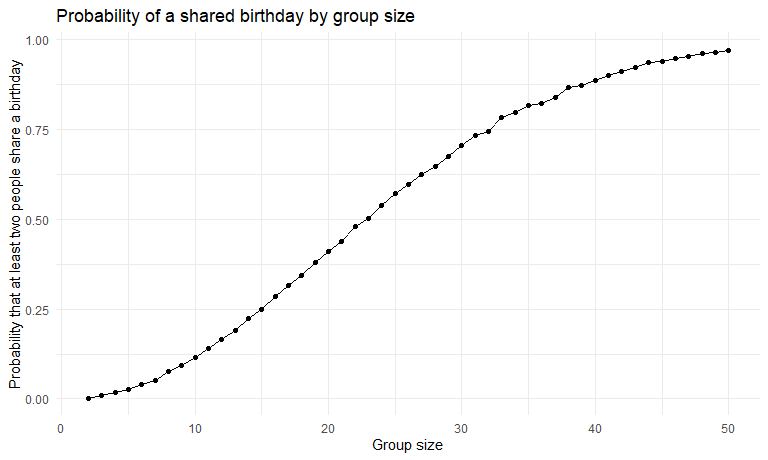
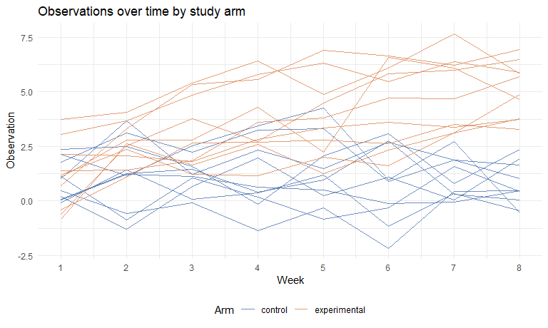

P8105 Homework 5
================
xx2554
2026-11-18

``` r
library(tidyverse)

set.seed(1)

knitr::opts_chunk$set(
  fig.width = 8,
  fig.asp = .6,
  out.width = "90%"
)

theme_set(theme_minimal() + theme(legend.position = "bottom"))
```

### Problem 1

#### Birthday simulation function

``` r
bday_sim = function(n) {
  
  bdays = sample(1:365, size = n, replace = TRUE)
  
  length(unique(bdays)) < n
  
}
```

#### Simulation across group sizes

``` r
bday_results = 
  expand_grid(
    group_size = 2:50,
    iter = 1:10000
  ) |> 
  mutate(shared = map_lgl(group_size, bday_sim)) |> 
  group_by(group_size) |> 
  summarize(prob = mean(shared))
```

#### Plot and comments

``` r
bday_results |> 
  ggplot(aes(x = group_size, y = prob)) + 
  geom_point() + 
  geom_line() + 
  labs(
    title = "Probability of a shared birthday by group size",
    x = "Group size",
    y = "Probability that at least two people share a birthday"
  )
```


The probability that at least two people share a birthday increases with
group size, but not linearly. It is near 0 for a group of 2 and only
about 0.12 for a group of 10, then rises quickly, reaching about 0.5 at
a group size of 23 and about 0.7 at 30. After that the curve flattens as
it approaches 1, with a probability of about 0.97 for a group of 50.

### Problem 2

#### Import data files

``` r
study_raw = 
  tibble(file_name = list.files("data")) |> 
  mutate(data = map(str_c("data/", file_name), read_csv))
```

#### Tidy data

``` r
study_df = 
  study_raw |> 
  unnest(data) |> 
  mutate(
    subject_id = str_remove(file_name, ".csv"),
    arm = if_else(str_detect(file_name, "con"), "control", "experimental")
  ) |> 
  pivot_longer(
    week_1:week_8,
    names_to = "week",
    names_prefix = "week_",
    values_to = "observation"
  ) |> 
  mutate(week = as.numeric(week)) |> 
  select(subject_id, arm, week, observation)

study_df
```

    ## # A tibble: 160 × 4
    ##    subject_id arm      week observation
    ##    <chr>      <chr>   <dbl>       <dbl>
    ##  1 con_01     control     1        0.2 
    ##  2 con_01     control     2       -1.31
    ##  3 con_01     control     3        0.66
    ##  4 con_01     control     4        1.96
    ##  5 con_01     control     5        0.23
    ##  6 con_01     control     6        1.09
    ##  7 con_01     control     7        0.05
    ##  8 con_01     control     8        1.94
    ##  9 con_02     control     1        1.13
    ## 10 con_02     control     2       -0.88
    ## # ℹ 150 more rows

#### Spaghetti plot and comments

``` r
study_df |> 
  ggplot(aes(x = week, y = observation, group = subject_id, color = arm)) + 
  geom_line(linewidth = 0.7, alpha = 0.8) + 
  scale_x_continuous(breaks = 1:8) + 
  scale_color_manual(values = c("control" = "#4C72B0", "experimental" = "#DD8452")) + 
  labs(
    title = "Observations over time by study arm",
    x = "Week",
    y = "Observation",
    color = "Arm"
  )
```


In week 1 the two arms overlap, with observations in both groups falling
in roughly the same range. Over the following weeks, observations in the
control arm fluctuate without a clear trend and stay mostly between 0
and 2.5, while observations in the experimental arm increase steadily.
By week 8 the two arms are completely separated, with every subject in
the experimental arm having a higher observation than every subject in
the control arm.

### Problem 3

#### Simulation function

#### Simulation for mu = 0

#### Simulation for mu = 1 to 6

#### Power plot

#### Average estimate plots
